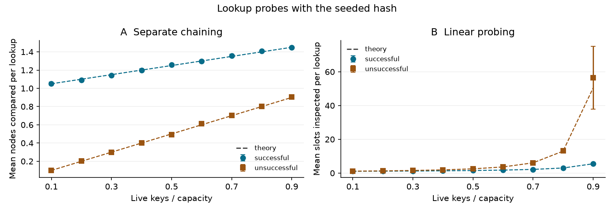

Q3. Why does linear probing need tombstones?

Author: Pankaj

Suppose two different keys, apple and mango, both start at slot 2. Apple gets slot 2. Mango sees slot 2 is occupied, so it moves to slot 3.

| State | Slot 2 | Slot 3 |
|---|---|---|
| Before deletion | apple | mango |
| Incorrect deletion | EMPTY | mango |
| Deletion with a tombstone | TOMBSTONE | mango |

A search for mango starts at slot 2. If deleting apple marks slot 2 EMPTY, the search stops there and wrongly reports that mango is missing. If slot 2 is a TOMBSTONE, the search continues to slot 3 and finds mango. In Structure B, `remove()` sets the slot to TOMBSTONE, and `get()` only stops early when it sees EMPTY.

## Measurements

**Member 5 · Adwit Tiwari**

Structure A uses separate chaining. Structure B uses linear probing. The probe and corpus measurements were collected with MSVC 14.50.35717, C++17 and `/O2`, on x64 Windows build 26300 with an Intel Core i7-14650HX. Each plotted point or bar is a mean of five runs. Error bars show one sample standard deviation.

### Lookup probes

For each load from 0.1 through 0.9, we created fresh tables with 4,096 positions and no deletions. We tested identical printable keys in the four structure/hash combinations. We performed one successful lookup for each stored key and the same number of unsuccessful lookups. A probe counts a node comparison in A or an inspected slot in B, including the empty slot that ends a miss.

| Load | Hash | A hit | A miss | B hit | B miss |
| ---: | --- | ---: | ---: | ---: | ---: |
| 0.1 | Fixed | 1.050 | 0.112 | 1.056 | 1.130 |
| 0.1 | Seeded | 1.051 | 0.100 | 1.056 | 1.115 |
| 0.5 | Fixed | 1.257 | 0.490 | 1.496 | 2.421 |
| 0.5 | Seeded | 1.256 | 0.493 | 1.514 | 2.456 |
| 0.9 | Fixed | 1.445 | 0.890 | 5.517 | 45.600 |
| 0.9 | Seeded | 1.446 | 0.906 | 5.481 | 56.424 |




For A at 90% load, successful lookups took about 1.45 comparisons, near the theoretical reference of 1.45. Misses took about 0.90 comparisons. For B, misses rose sharply as occupied slots formed longer clusters. At 90% load, the fixed and seeded means fell on either side of the 50.50-probe reference. Their across-run standard deviations were 5.90 and 18.56 slots respectively, so a single high-load run can differ substantially from the reference. [Raw probe data](results/probes.csv)

### Corpus word-count timing

The team corpus contains 366,832 word tokens and 10,307 distinct words under the application's ASCII tokenization. We timed the lookups, count updates, and any resizing on fresh tables. Tokenization and validation ran outside the timer. Every run matched independently accumulated word counts.

| Structure | Fixed (ms) | Seeded (ms) |
| --- | ---: | ---: |
| A | 24.37 ± 3.01 | 1,088.54 ± 73.65 |
| B | 19.36 ± 1.86 | 1,065.77 ± 70.41 |


Seeded hashing took more time on this corpus in both structures. The seeded implementation restarts its pseudorandom generator on every hash call. That cost is part of what we timed. These runs did not isolate how much time the hash itself consumed. [Raw corpus data](results/corpus.csv)

### Fixed and seeded replay on the supplied collision workloads

Each workload contains one insert and one lookup per distinct key. The replay timer covers command parsing, table operations and creation of the in-memory answers. The table gives mean milliseconds from five numbered runs per cell. All 60 runs recorded PASS and the expected final key count. Seeded runs used seed 42. The six supplied CSVs contain both modes for each structure and size. Their machine, compiler and build flags were not recorded.

| Distinct keys | Commands | A fixed (ms) | A seeded (ms) | B fixed (ms) | B seeded (ms) |
| ---: | ---: | ---: | ---: | ---: | ---: |
| 1,024 | 2,048 | 21.59 | 18.65 | 28.58 | 8.52 |
| 4,096 | 8,192 | 241.15 | 79.54 | 355.08 | 33.35 |
| 8,192 | 16,384 | 957.43 | 159.42 | 1,345.13 | 60.04 |


At 8,192 keys, the fixed replay took 6.0 times as long as the seeded replay for chaining and 22.4 times as long for linear probing. Doubling the workload from 4,096 to 8,192 keys increased fixed replay time by about fourfold for each structure, while seeded replay time grew by about twofold. These comparisons use the paired modes from the supplied files. The earlier local seeded measurements are archived separately.

Run `python bench/plot_replay.py` from the repository root to validate the numbered runs, check the recorded means and regenerate the figure. [Raw replay CSVs](results/replay) · [Earlier seeded measurements](results/seeded_replay.csv)

### Reproduce the probe and corpus results

From the repository root in an x64 Native Tools Command Prompt for Visual Studio, with Python and Matplotlib installed:

```bat
cl /nologo /std:c++17 /EHsc /O2 bench\measure.cpp src\structA\StructureA.cpp /Fe:measure.exe
measure.exe probes > results\probes.csv
measure.exe corpus data\corpus.txt > results\corpus.csv
python bench\plot_measurements.py
```

The experiment notes record the input seeds, probe definitions, and build commands for GCC and Clang. [Experiment protocol](bench/EXPERIMENTS.md)

## Q5. How does a random seed affect the chain containing a stored key?

**Member 5 · Adwit Tiwari**

Fix a set of n distinct keys and choose one stored key x. Its chain already contains x. Every other key y adds one more node exactly when y and x land in the same bucket. A universal family chooses a hash function at random such that, for each fixed pair of distinct keys, the probability of a shared bucket is at most 1/m, where m is the number of buckets. Summing the n − 1 collision probabilities gives

**E[length of x’s chain] ≤ 1 + (n − 1)/m = 1 + α − 1/m**, where α = n/m.

The expectation is over the hash choice. Linearity of expectation lets us add these probabilities even when the collision events depend on each other. If each pair collides with probability exactly 1/m, the bound is an equality. At half load, a stored key therefore sees about 1.5 nodes in its full chain under that model. A lookup can stop before reaching the end of the chain.

### What the team's code does

The fixed hash uses base 31. The team's `SeededHash` restarts a pseudorandom generator from the same seed on every call, producing one repeatable coefficient per character position. It multiplies each coefficient by the corresponding unsigned byte plus one, sums modulo 1,000,000,007, and Structure A reduces the result modulo the bucket count. All keys in a table use the same coefficients. A different seed changes how the original characters contribute, so two strings that shared a fixed hash can move apart. Applying a seed only to their already equal hash values would give equal outputs again.

The bound above assumes a pairwise collision guarantee for the **final bucket index**, with the input chosen independently of the hash. Pseudorandom coefficients and a final reduction modulo m warrant an empirical check. Knowing the seed and then choosing the inputs falls outside that assumption.

### What the implementation measured

We held the input sequence fixed and varied only the hash seed at each load. With 4,096 buckets and 16 seeds, we looked up every stored key at each of nine loads and verified its value. A bucket of length k is seen by k stored keys, so the measured mean full chain length is the sum of k² over buckets divided by n. We checked this against the table's actual successful lookup counts at every load.

| Nominal load | Distinct keys | Universal-family reference | Measured full chain (nodes) | Successful lookup (nodes compared) |
| --- | ---: | ---: | ---: | ---: |
| 0.1 | 409 | 1.100 | 1.108 | 1.054 |
| 0.5 | 2,048 | 1.500 | 1.509 | 1.255 |
| 0.9 | 3,686 | 1.900 | 1.903 | 1.452 |


At the highest load, the complete chain averaged 1.903 nodes and a successful lookup examined 1.452. The difference comes from stopping when the requested key is found. The finite-seed averages tracked the reference across this input set. An expectation bound allows individual samples and finite averages on either side of the reference. A guarantee for every fixed pair would require a separate proof for the implemented family.

[Measurement protocol and build commands](bench/SEEDED_HASH_NOTES.md) · [Raw runs](results/q5_chain_length.csv) · [Team implementation](src/structA/StructureA.cpp) · [James Aspnes, Yale, *Randomization*, section on universal hashing](https://www.cs.yale.edu/homes/aspnes/pinewiki/C%282f%29Randomization.html)
