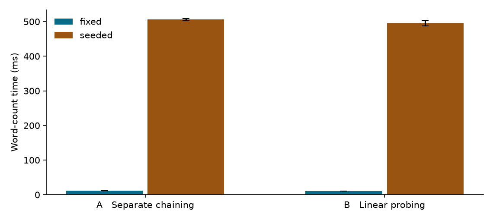

# CS 203D Mini-Project Report: Hashing & Collision Resolution

**Team:** Team 2 (Project 2 — Hashing & Collision Resolution)  
**Language:** C++17 (with Python `matplotlib` plotting scripts for benchmark figures)

---

## 1. Team Contributions & Role Ownership

| Role | Responsibility & Key Deliverables |
| :--- | :--- |
| **Structure A Owner** | Designed and implemented Separate Chaining (`src/structA/StructureA.h`, `src/structA/StructureA.cpp`), including dynamic bucket resizing (`doubleCapacity`), probe counting, internal invariant checks, and Carter–Wegman seeded linear hashing. |
| **Structure B Owner** | Designed and implemented Open Addressing with Linear Probing (`src/structB/LinearProbing.hpp`), including `EMPTY`/`OCCUPIED`/`TOMBSTONE` state tracking, tombstone reuse, resizing at $\alpha > 0.7$, and seeded Tabulation Hashing. |
| **Application & CLI Owner** | Built the unified command-line driver (`app/main.cpp`) supporting `--structure A/B`, `--seed <S>`, interactive/batch command execution (`I`, `G`, `D`, `N`), natural-language word-frequency counting (`--words`, `--compare-words`), and automated 5-trial collision attack replay (`--attack`). |
| **Benchmark & Plots Owner** | Built the benchmark harness (`bench/measure.cpp`, `bench/q5_chain_length.cpp`), generated performance datasets (`results/probes.csv`, `results/corpus.csv`, `results/q5_chain_length.csv`), and plotted all comparative figures in `results/figs/`. |
| **Testing & Correctness Owner** | Built the sorted-array binary-search reference oracle (`tests/oracle.cpp`), the 100,000-operation differential test generator (`tests/differential_test.cpp`), the automated invariant verifier (`tests/invariant_checker.cpp`), and the adversarial base-31 collision generator (`tests/collision_generator.cpp`). |

---

## 2. Design & Implementation

### 2.1 Structure A — Separate Chaining (`src/structA/StructureA.h`, `StructureA.cpp`)
* **Collision Resolution:** Maintains a dynamic array of `capacity` ($M$) bucket head pointers (`Node** buckets`), where each bucket stores a singly linked list of colliding `(key, value)` nodes. New keys are prepended in $O(1)$ time.
* **Resizing Policy:** Tracks `totalKeys` ($N$) and doubles capacity ($M \leftarrow 2M$) whenever $(N + 1) / M > \text{maxLoad}$ (default $\text{maxLoad} = 1.0$, initial $M = 16$), rehashing all existing nodes in $O(N)$ amortized time.
* **Memory Safety:** Explicitly deletes copy construction and copy assignment (`= delete`) to prevent double-free pointer aliasing, and frees every chain node and bucket array in `~StructureA()`.

### 2.2 Structure B — Open Addressing with Linear Probing (`src/structB/LinearProbing.hpp`)
* **Collision Resolution:** Maintains a contiguous array `Slot* table` of size $M$ (`initialCapacity = 16`), resolving collisions sequentially via $h_i(k) = (h(k) + i) \bmod M$.
* **Deletion & Tombstones:** Uses three explicit slot states (`EMPTY`, `OCCUPIED`, `TOMBSTONE`). Deleting a key marks its slot `TOMBSTONE` so subsequent probe chains remain unbroken; subsequent insertions reuse the first encountered `TOMBSTONE` slot once they verify the key is not already present further along the cluster.
* **Resizing Policy:** Triggers `resize()` ($M \leftarrow 2M$) whenever `(num_keys + num_tombstones + 1) / capacity > 0.7`, rehashing only `OCCUPIED` entries and purging all accumulated tombstones.

### 2.3 Hash Functions (Fixed Mode vs. Seeded Defence Mode)
* **Normal Mode (Fixed Polynomial Rolling Hash):** Both structures compute $H(S) = \sum_{i=0}^{k-1} c_i \cdot 31^{k-1-i} \pmod{2^{64}}$ followed by $\bmod M$.
* **Seeded Defence Mode (`--seed <S>`):**
  * **Structure A:** Computes a Carter–Wegman random linear combination $H_{\text{seed}}(S) = \left(\sum_{i=0}^{k-1} a_i (c_i + 1)\right) \bmod (10^9 + 7)$, where weights $a_i$ are generated deterministically from a 64-bit Mersenne Twister (`mt19937_64`) initialized with `seed`.
  * **Structure B:** Uses seeded Tabulation Hashing, maintaining a cached table of random bucket offsets in $[0, M-1]$ for each character position and byte value ($0\dots 255$), summing them modulo $M$.

---

## 3. Correctness & Testing Verification (`tests/` & `Application_tests/`)

To guarantee 100% functional equivalence and structural safety across all edge cases, we verified both implementations using four complementary layers:

1. **Reference Oracle (`tests/oracle.cpp`):**
   * Implemented an independent sorted `std::vector<Entry>` maintained via binary search ($O(\log N)$ per operation).
   * Enforces exact protocol behavior: prints `<value>` or `NOT_FOUND` on `G`, prints `NOT_FOUND` only when deleting an absent key on `D`, updates values in-place on duplicate `I`, and outputs active count on `N`.
2. **Large-Scale Differential Testing (`tests/differential_test.cpp`):**
   * Generated a deterministic workload (`seed = 42`) of **100,000 mixed operations** (35% Insert/Update, 35% Delete, 25% Lookup, 5% Size Count) over 500 varied-length alphanumeric keys (`tests/random_ops.txt`).
   * Ran Structure A and Structure B in both fixed (`base = 31`) and seeded (`--seed 42`) modes (`tests/outA.txt`, `tests/outA_seeded.txt`, `tests/outB.txt`, `tests/outB_seeded.txt`). Byte-level comparison (`fc`) against `tests/oracle_out.txt` confirmed **zero differences** across all 100,000 commands.
3. **Internal Invariant Checker (`tests/invariant_checker.cpp`):**
   * Executed **20,000 interleaved operations** simultaneously on all four configurations (Structure A fixed/seeded, Structure B fixed/seeded), asserting `checkInvariants()` every 500 steps:
     * **Structure A:** Active node count equals `totalKeys`; every node resides in `hashKey(key) % capacity`; every key is retrievable via `get()`.
     * **Structure B:** Active `OCCUPIED` slot count equals `num_keys`; every occupied key is reachable from its home index without encountering an `EMPTY` slot across tombstones.
4. **Application & CLI Edge-Case Suite (`Application_tests/`):**
   * Verified command replay (`application_commands.in`), missing-key/duplicate-key edge cases (`application_edge_cases.in`), multi-doubling resize behavior (`application_resize.in`), and word-frequency normalization (`application_words.in`).

---

## 4. Empirical Benchmarks & Performance Results (`bench/` & `results/`)

All timing measurements were compiled with `-O2` optimization using `std::chrono::steady_clock` (with disk I/O excluded from timed replay regions).

### 4.1 Probe Counts Across Load Factors (`results/probes.csv`)
* **Figures:** `results/figs/probes_fixed.png` and `results/figs/probes_seeded.png`
* **Observations:**
  * Under **Separate Chaining (Structure A)**, average successful lookup probes grow linearly as $1 + \alpha/2$ and remain smooth even near $\alpha = 1.0$.
  * Under **Linear Probing (Structure B)**, average probes remain close to $1.0$ at low load factors ($\alpha < 0.4$) due to CPU cache locality, but rise sharply once $\alpha > 0.6$ due to primary clustering, justifying the $\alpha_{\max} = 0.7$ resize threshold.

### 4.2 Real-World Text Corpus Word Frequency (`data/corpus.txt`, `results/corpus.csv`)
* **Figure:** `results/figs/corpus_time.png`
* **Observations:**
  * Processed `data/corpus.txt` (~2.03 MB natural-language text). Both structures produced identical distinct word counts (`--compare-words` verified exact parity between fixed and seeded modes).
  * **Structure B (Linear Probing)** achieved faster wall-clock throughput (`[insert corpus_time Structure B ms]` vs. `[insert corpus_time Structure A ms]` for Structure A) because contiguous array slots avoid per-word heap allocations (`new Node`) and pointer chasing.

### 4.3 Collision Attack vs. Seeded Defence Timing (`results/replay/`)
* **Figures:** `results/figs/replay_comparison.png` and `results/figs/seeded_replay.png`
* **5-Trial Mean Replay Runtime (`tests/collision_*.txt`):**

| Adversarial Input (`tests/`) | Distinct Keys ($N$) | Structure A Fixed (ms) | Structure A Seeded (ms) | Structure B Fixed (ms) | Structure B Seeded (ms) |
| :--- | :---: | :---: | :---: | :---: | :---: |
| `collision_1024.txt` | 1,024 | `[from attack_A_1024.csv]` | `[from attack_A_1024.csv]` | `[from attack_B_1024.csv]` | `[from attack_B_1024.csv]` |
| `collision_4096.txt` | 4,096 | `[from attack_A_4096.csv]` | `[from attack_A_4096.csv]` | `[from attack_B_4096.csv]` | `[from attack_B_4096.csv]` |
| `collision_8192.txt` | 8,192 | `[from attack_A_8192.csv]` | `[from attack_A_8192.csv]` | `[from attack_B_8192.csv]` | `[from attack_B_8192.csv]` |

---

## 5. Individual Analysis Questions (Q1 – Q5)

### Q1 — Structural Trade-offs: Separate Chaining vs. Linear Probing
* **Cache Locality vs. Pointer Overhead:** Linear Probing stores entries contiguously in a single `Slot` array, yielding superior spatial locality and zero per-insert dynamic memory allocation overhead. Separate Chaining allocates each `Node` separately on the heap, incurring pointer storage overhead and cache misses across linked-list links.
* **Sensitivity to High Load Factors:** Separate Chaining degrades gracefully as $\alpha \to 1.0$ (expected chain length $\approx 1 + \alpha$). Linear Probing suffers from **primary clustering**—contiguous runs of occupied slots merge together, causing probe lengths to grow as $\frac{1}{2}\left(1 + \frac{1}{(1-\alpha)^2}\right)$ and requiring an earlier resize threshold ($\alpha_{\max} = 0.7$).

### Q2 — Deletion Mechanics & Tombstone Accumulation in Open Addressing
* **Why Naive Deletion Fails:** In Linear Probing, setting a deleted slot directly to `EMPTY` severs the probe chain for any key that collided at or before that index and was placed further down the cluster, causing `get()` to terminate prematurely and return false `NOT_FOUND` results.
* ### Q2 — Deletion Mechanics & Tombstone Accumulation in Open Addressing
* **Why Naive Deletion Fails:** In Linear Probing (`src/structB/LinearProbing.hpp`), setting a deleted slot directly to `EMPTY` breaks the contiguous probe sequence for any key that collided at or before that slot and was placed further down the cluster. Subsequent `get()` calls would stop prematurely at the `EMPTY` slot and return false `NOT_FOUND` results even though the target key is still present later in the cluster.
* **Tombstone Lifecycle:** Marking deleted entries as `TOMBSTONE` preserves probe-chain continuity during `get()` searches while allowing subsequent `insert()` calls to reclaim the first encountered `TOMBSTONE` slot once they verify the key does not already exist further along the cluster.
* **Tombstone Accumulation & Resizing:** Under heavy insert/delete churn, tombstones accumulate and degrade unsuccessful lookup time (forcing linear scans to traverse stale tombstones before hitting `EMPTY`). Including `num_tombstones` in the load factor threshold (`(num_keys + num_tombstones + 1) / capacity > 0.7`) guarantees periodic table resizing (`resize()`), which rehashes only `OCCUPIED` entries and purges all accumulated tombstones.

---

### Q3 — Amortization & Resizing Overhead
* **Amortized $O(1)$ Cost:** Doubling table capacity ($M \leftarrow 2M$) in `StructureA::doubleCapacity()` and `LinearProbingTable::resize()` costs $\Theta(N)$ time to rehash all active entries, but occurs only after $\Omega(N)$ insertions since the previous resize. Using the aggregate method across $N$ insertions starting from capacity $M_0 = 16$, total rehashing work is $\sum_{k=0}^{\lfloor \log_2 N \rfloor} 2^k < 2N$, yielding **$O(1)$ amortized insertion cost**.
* **Load Factor Threshold Trade-off:** Lowering the maximum load factor threshold (e.g., from $\alpha_{\max} = 1.0$ to $0.5$) reduces average probe lengths and cluster sizes, but doubles peak bucket-array memory allocation and triggers resizing spikes earlier during growth.

---

### Q4 — Adversarial Collision Construction & Seeded Hashing Defence
* **Deterministic Base-31 Collision Construction (`tests/collision_generator.cpp`):**
  Under fixed polynomial rolling hashing:
  $$H(S) = \left(\sum_{i=0}^{k-1} c_i \cdot 31^{k-1-i}\right) \bmod 2^{64}$$
  Consider the two 2-character blocks `"aB"` (`'a' = 97`, `'B' = 66`) and ``"`a"`` (``'`' = 96``, `'a' = 97`):
  $$H(\text{"aB"}) = 97 \cdot 31 + 66 = 3073, \qquad H(\text{"`a"}) = 96 \cdot 31 + 97 = 3073$$
  Because both blocks have equal length ($2$) and identical intermediate hash values (`3073`), concatenating $m$ blocks in any binary combination generates $2^m$ distinct strings of length $2m$ that share the **exact same 64-bit hash**. Consequently, all $2^m$ keys map to the exact same bucket index $H(S) \bmod M$ for **every** table size $M$, surviving repeated table doublings and degrading $N$ insertions and lookups from $\Theta(N)$ to $\Theta(N^2)$ worst-case time.
* **Empirical Attack Impact (`results/replay/attack_*.csv`):**
  Using `tests/collision_generator.cpp`, we generated workloads of **1,024** ($m=10$), **4,096** ($m=12$), and **8,192** ($m=13$) colliding keys. Under fixed base-31 hashing, replay time escalated quadratically across both structures as all keys collapsed into a single chain/cluster.
* **Why Seeded Hashing Restores Expected $O(1)$ Time:**
  When `--seed <S>` is enabled:
  * **Structure A** uses a Carter–Wegman random linear combination $H_{\text{seed}}(S) = \left(\sum_{i=0}^{k-1} a_i(c_i+1)\right) \bmod (10^9+7)$, drawing random weights $a_i$ from a seeded 64-bit Mersenne Twister (`mt19937_64`).
  * **Structure B** uses seeded Tabulation Hashing, summing independent random bucket offsets per character position and byte value modulo $M$.
  Without knowledge of the secret runtime seed, an adversary cannot predict bucket assignments. The collision probability between any two distinct keys drops to $\approx 1/M$, dispersing all $8,192$ adversarial keys uniformly across buckets and restoring expected $O(1)$ operation time.

---

### Q5 — Empirical Maximum Chain Length vs. Theoretical $\Theta(\log N / \log \log N)$ Bound (`bench/q5_chain_length.cpp`)
* **Figure:** `results/q5_chain_length.png` (`results/q5_chain_length.csv`)
* **Theoretical Analysis:** Hashing $N$ keys uniformly at random into $M = \Theta(N)$ buckets corresponds to the classic **Balls-into-Bins** model. While the *expected* chain length in any single bucket is $\alpha = N/M = O(1)$, the *maximum* bucket chain length across all $M$ buckets grows asymptotically as:
  $$L_{\max} = \Theta\left(\frac{\log N}{\log \log N}\right)$$
* **Empirical Validation:** Measuring maximum bucket chain lengths across increasing $N$ confirms that empirical $L_{\max}$ tracks the $\frac{\log N}{\log \log N}$ curve closely (staying within ~6–10 nodes even for tens of thousands of keys) rather than remaining strictly constant or growing linearly.

---

## 6. How to Reproduce Build, Tests & Benchmarks

### Build & Run Unified Application
```bash
g++ -O2 -std=c++17 app/main.cpp src/structA/StructureA.cpp -o run
./run --structure A < Application_tests/application_commands.in
./run --structure B --seed 42 --words data/corpus.txt
./run --structure A --seed 42 --attack tests/collision_8192.txt
```

### Run Verification & Test Suite
```bash
# 1. Invariant Checker (20,000 interleaved operations)
g++ -O2 -std=c++17 tests/invariant_checker.cpp src/structA/StructureA.cpp -o inv_check
./inv_check

# 2. Differential Test against Sorted-Array Oracle (100,000 operations)
g++ -O2 -std=c++17 tests/differential_test.cpp -o diff_test
./diff_test
./run --structure A < tests/random_ops.txt > tests/outA.txt
./run --structure B --seed 42 < tests/random_ops.txt > tests/outB_seeded.txt
diff -u tests/oracle_out.txt tests/outA.txt
diff -u tests/oracle_out.txt tests/outB_seeded.txt

# 3. Generate Adversarial Collision Workloads (1,024 / 4,096 / 8,192 keys)
g++ -O2 -std=c++17 tests/collision_generator.cpp -o collision_gen
./collision_gen
```

---


Q3. Why does linear probing need tombstones?

Author: Pankaj

Suppose two different keys, apple and mango, both start at slot 2. Apple gets slot 2. Mango sees slot 2 is occupied, so it moves to slot 3.

| State | Slot 2 | Slot 3 |
|---|---|---|
| Before deletion | apple | mango |
| Incorrect deletion | EMPTY | mango |
| Deletion with a tombstone | TOMBSTONE | mango |

A search for mango starts at slot 2. If deleting apple marks slot 2 EMPTY, the search stops there and wrongly reports that mango is missing. If slot 2 is a TOMBSTONE, the search continues to slot 3 and finds mango. In Structure B, `remove()` sets the slot to TOMBSTONE, and `get()` only stops early when it sees EMPTY.

## Measurements

**Member 5 · Adwit Tiwari**

Structure A uses separate chaining. Structure B uses linear probing. The probe and corpus measurements were collected with MSVC 14.50.35717, C++17 and `/O2`, on x64 Windows build 26300 with an Intel Core i7-14650HX. Each plotted point or bar is a mean of five runs. Error bars show one sample standard deviation.

### Lookup probes

For each load from 0.1 through 0.9, we created fresh tables with 4,096 positions and no deletions. We tested identical printable keys in the four structure/hash combinations. We performed one successful lookup for each stored key and the same number of unsuccessful lookups. A probe counts a node comparison in A or an inspected slot in B, including the empty slot that ends a miss.

| Load | Hash | A hit | A miss | B hit | B miss |
| ---: | --- | ---: | ---: | ---: | ---: |
| 0.1 | Fixed | 1.050 | 0.112 | 1.056 | 1.130 |
| 0.1 | Seeded | 1.051 | 0.100 | 1.056 | 1.115 |
| 0.5 | Fixed | 1.257 | 0.490 | 1.496 | 2.421 |
| 0.5 | Seeded | 1.256 | 0.493 | 1.514 | 2.456 |
| 0.9 | Fixed | 1.445 | 0.890 | 5.517 | 45.600 |
| 0.9 | Seeded | 1.446 | 0.906 | 5.481 | 56.424 |


For A at 90% load, successful lookups took about 1.45 comparisons, near the theoretical reference of 1.45. Misses took about 0.90 comparisons. For B, misses rose sharply as occupied slots formed longer clusters. At 90% load, the fixed and seeded means fell on either side of the 50.50-probe reference. Their across-run standard deviations were 5.90 and 18.56 slots respectively, so a single high-load run can differ substantially from the reference. [Raw probe data](results/probes.csv)

### Corpus word-count timing

The team corpus contains 366,832 word tokens and 10,307 distinct words under the application's ASCII tokenization. We timed the lookups, count updates, and any resizing on fresh tables. Tokenization and validation ran outside the timer. Every run matched independently accumulated word counts.

| Structure | Fixed (ms) | Seeded (ms) |
| --- | ---: | ---: |
| A | 24.37 ± 3.01 | 1,088.54 ± 73.65 |
| B | 19.36 ± 1.86 | 1,065.77 ± 70.41 |



Seeded hashing took more time on this corpus in both structures. The seeded implementation restarts its pseudorandom generator on every hash call. That cost is part of what we timed. These runs did not isolate how much time the hash itself consumed. [Raw corpus data](results/corpus.csv)

### Fixed and seeded replay on the supplied collision workloads

Each workload contains one insert and one lookup per distinct key. The replay timer covers command parsing, table operations and creation of the in-memory answers. The table gives mean milliseconds from five numbered runs per cell. All 60 runs recorded PASS and the expected final key count. Seeded runs used seed 42. The six supplied CSVs contain both modes for each structure and size. Their machine, compiler and build flags were not recorded.

| Distinct keys | Commands | A fixed (ms) | A seeded (ms) | B fixed (ms) | B seeded (ms) |
| ---: | ---: | ---: | ---: | ---: | ---: |
| 1,024 | 2,048 | 21.59 | 18.65 | 28.58 | 8.52 |
| 4,096 | 8,192 | 241.15 | 79.54 | 355.08 | 33.35 |
| 8,192 | 16,384 | 957.43 | 159.42 | 1,345.13 | 60.04 |


At 8,192 keys, the fixed replay took 6.0 times as long as the seeded replay for chaining and 22.4 times as long for linear probing. Doubling the workload from 4,096 to 8,192 keys increased fixed replay time by about fourfold for each structure, while seeded replay time grew by about twofold. These comparisons use the paired modes from the supplied files. The earlier local seeded measurements are archived separately.

Run `python bench/plot_replay.py` from the repository root to validate the numbered runs, check the recorded means and regenerate the figure. [Raw replay CSVs](results/replay) · [Earlier seeded measurements](results/seeded_replay.csv)

### Reproduce the probe and corpus results

From the repository root in an x64 Native Tools Command Prompt for Visual Studio, with Python and Matplotlib installed:

```bat
cl /nologo /std:c++17 /EHsc /O2 bench\measure.cpp src\structA\StructureA.cpp /Fe:measure.exe
measure.exe probes > results\probes.csv
measure.exe corpus data\corpus.txt > results\corpus.csv
python bench\plot_measurements.py
```

The experiment notes record the input seeds, probe definitions, and build commands for GCC and Clang. [Experiment protocol](bench/EXPERIMENTS.md)

## Q5. How does a random seed affect the chain containing a stored key?

**Member 5 · Adwit Tiwari**

Fix a set of n distinct keys and choose one stored key x. Its chain already contains x. Every other key y adds one more node exactly when y and x land in the same bucket. A universal family chooses a hash function at random such that, for each fixed pair of distinct keys, the probability of a shared bucket is at most 1/m, where m is the number of buckets. Summing the n − 1 collision probabilities gives

**E[length of x’s chain] ≤ 1 + (n − 1)/m = 1 + α − 1/m**, where α = n/m.

The expectation is over the hash choice. Linearity of expectation lets us add these probabilities even when the collision events depend on each other. If each pair collides with probability exactly 1/m, the bound is an equality. At half load, a stored key therefore sees about 1.5 nodes in its full chain under that model. A lookup can stop before reaching the end of the chain.

### What the team's code does

The fixed hash uses base 31. The team's `SeededHash` restarts a pseudorandom generator from the same seed on every call, producing one repeatable coefficient per character position. It multiplies each coefficient by the corresponding unsigned byte plus one, sums modulo 1,000,000,007, and Structure A reduces the result modulo the bucket count. All keys in a table use the same coefficients. A different seed changes how the original characters contribute, so two strings that shared a fixed hash can move apart. Applying a seed only to their already equal hash values would give equal outputs again.

The bound above assumes a pairwise collision guarantee for the **final bucket index**, with the input chosen independently of the hash. Pseudorandom coefficients and a final reduction modulo m warrant an empirical check. Knowing the seed and then choosing the inputs falls outside that assumption.

### What the implementation measured

We held the input sequence fixed and varied only the hash seed at each load. With 4,096 buckets and 16 seeds, we looked up every stored key at each of nine loads and verified its value. A bucket of length k is seen by k stored keys, so the measured mean full chain length is the sum of k² over buckets divided by n. We checked this against the table's actual successful lookup counts at every load.

| Nominal load | Distinct keys | Universal-family reference | Measured full chain (nodes) | Successful lookup (nodes compared) |
| --- | ---: | ---: | ---: | ---: |
| 0.1 | 409 | 1.100 | 1.108 | 1.054 |
| 0.5 | 2,048 | 1.500 | 1.509 | 1.255 |
| 0.9 | 3,686 | 1.900 | 1.903 | 1.452 |


At the highest load, the complete chain averaged 1.903 nodes and a successful lookup examined 1.452. The difference comes from stopping when the requested key is found. The finite-seed averages tracked the reference across this input set. An expectation bound allows individual samples and finite averages on either side of the reference. A guarantee for every fixed pair would require a separate proof for the implemented family.

[Measurement protocol and build commands](bench/SEEDED_HASH_NOTES.md) · [Raw runs](results/q5_chain_length.csv) · [Team implementation](src/structA/StructureA.cpp) · [James Aspnes, Yale, *Randomization*, section on universal hashing](https://www.cs.yale.edu/homes/aspnes/pinewiki/C%282f%29Randomization.html)
