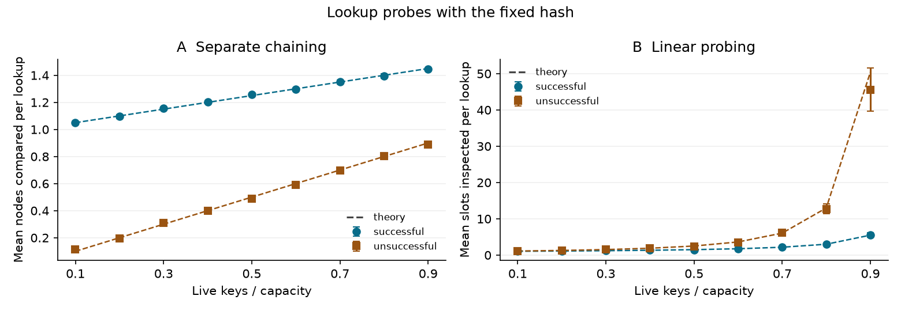
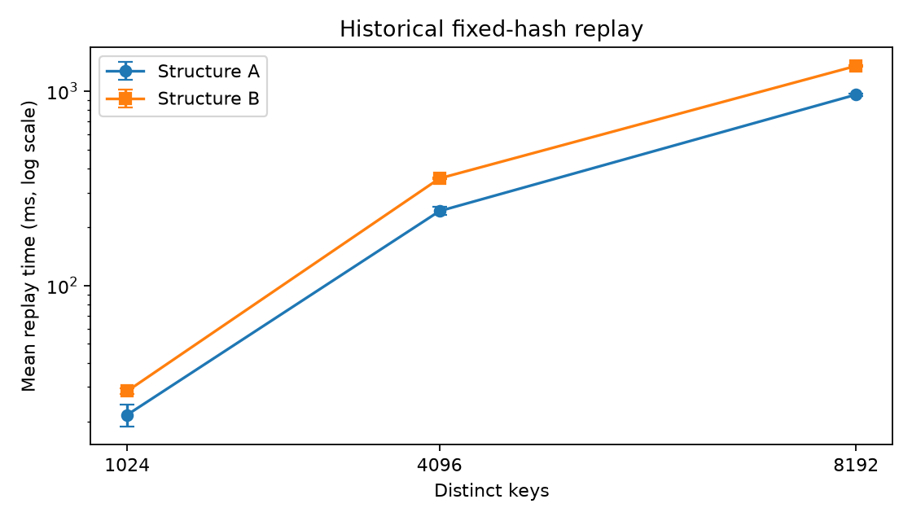
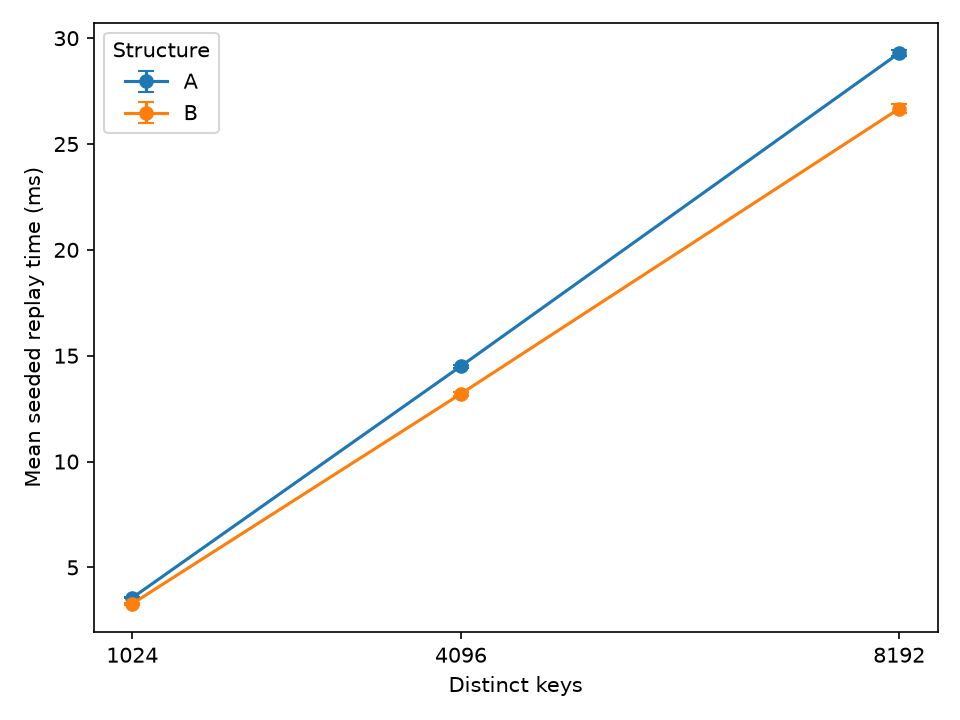

# Hash Tables and How to Break Them

**CS 203D · Project 2 · Team 2 (`cs203D-team2-p2`)**
Structure A: separate chaining · Structure B: linear probing with tombstones

The probe, corpus, Q5 and seeded replay results were collected with the shared hash implementation in this repository. Section 6.4 separately labels the earlier fixed-hash baseline.

---

## 1. Team and contributions

| Member | Roll no. | GitHub | Role (project spec) | Question |
| --- | --- | --- | --- | --- |
| Ritik Gupta | 250004036 | `ritikgup-g` | Structure A owner | Q1 |
| Kartikey Gupta | 250003045 | `kartikey357` | Structure B owner | Q2 |
| Pankaj Soni | 250004028 | `pankajsoni1661-stack` | Application owner | Q3 |
| Shubham Poddar | 250004032 | `subham2352007-eng` | Test owner (also builds the worst-case inputs, as the spec asks of a five-member team) | Q4 |
| Adwit Tiwari | 250004004 | `Adwit-webdev` | Measurement owner | Q5 |

The team has five members, so Q6 is not required.

**What each member built**

| Member | Main files | What they contain |
| --- | --- | --- |
| Ritik | `src/structA/StructureA.h`, `StructureA.cpp` | Separate chaining. Fixed base-31 hash, seeded hash, doubling resize, deletion, probe counting, `loadFactor()`, `checkInvariants()`. |
| Kartikey | `src/structB/LinearProbing.hpp`, `Structure_B.cpp`, `tests/test_StructB.cpp` | Linear probing with `EMPTY/OCCUPIED/TOMBSTONE` slots, a configurable `max_load_factor`, resize that clears tombstones, the shared seeded hash, five unit tests. |
| Pankaj | `app/main.cpp`, `Application_tests/` | The `--structure A\|B` entry point, the `I/G/D/N` command mode, the word-frequency counter (`--words`, `--compare-words`), the attack replay (`--attack`), four input/expected-output fixtures. |
| Shubham | `tests/oracle.cpp`, `differential_test.cpp`, `invariant_checker.cpp`, `collision_generator.cpp` | Sorted-array oracle, 10⁵-operation differential test, invariant checker for both tables, block-substitution collision files of 1,024 / 4,096 / 8,192 keys. |
| Adwit | `bench/` (`measure.cpp`, `q5_chain_length.cpp`, plotting scripts, `EXPERIMENTS.md`, `SEEDED_HASH_NOTES.md`), `results/` | Probe, corpus and replay measurements and every figure in section 6. |

**Selected contributions.** [Ritik · chaining](https://github.com/pankajsoni1661-stack/cs203D-team2-p2/commit/f83fc57846a19b710170549ceaf4d568176e79e9), [Kartikey · probing](https://github.com/pankajsoni1661-stack/cs203D-team2-p2/commit/62e8b3d3e369b75a1cdb62a034e613fb98be7e68), [Pankaj · application](https://github.com/pankajsoni1661-stack/cs203D-team2-p2/commit/11af590235f178bcbb8b83dac337e81db23985db), [Shubham · testing](https://github.com/pankajsoni1661-stack/cs203D-team2-p2/commit/71b4267228eaea62c0f914cf252cdefe8802df2c), [Adwit · measurements](https://github.com/pankajsoni1661-stack/cs203D-team2-p2/commit/69e5f7eb24d4cddfa54aca738b9cb4954dca7c49).

*Tool use* is declared in `TOOLS.md` (see section 9 for what that file still needs).

---

## 2. Problem

A key-value store holds up to one million string keys, with integer values. Keys are printable ASCII without spaces. It must stay fast even if an attacker who knows the hash function sends keys that all collide.

Both structures support the same four operations, and both print identical output on every input:

| Command | Meaning | Output |
| --- | --- | --- |
| `I key value` | insert, or update if the key exists | none |
| `G key` | look up | the value, or `NOT_FOUND` |
| `D key` | delete | `NOT_FOUND` if absent, otherwise none |
| `N` | count stored keys | the number |

The application has three modes. **Command mode** replays an `I/G/D/N` file. The **word-frequency counter** reads a text file, lowercases ASCII letters, splits at every other byte and prints each word's count in first-appearance order. The **attack mode** replays a file of colliding keys against the fixed hash and against a seeded hash, five times each, checking that both give the same answers and the same final contents.

Two hash functions matter. The **fixed** hash is a base-31 polynomial hash that an attacker can predict. The **seeded** hash uses random coefficients chosen from a seed, so a block-substitution attack built for the fixed hash no longer lines up.

---

## 3. Structure A: separate chaining

**Author of this part of the code: Ritik Gupta.**

### 3.1 How it is stored

```
buckets ──► [ 0 ] ─► Node{key,value,next} ─► Node ─► null
            [ 1 ] ─► null
            [ 2 ] ─► Node ─► null
              ⋮
capacity buckets, totalKeys nodes, maxLoad (default 1.0)
```

`buckets` is an array of `Node*` list heads, created with `new Node*[capacity]()` so every head starts as `nullptr`. Each key lives in one heap-allocated `Node{string key; int value; Node* next;}` on the list for bucket `hash(key) % capacity`. The table starts with 16 buckets. Copying is deleted, so two tables cannot free the same nodes.

### 3.2 The two hash functions

| | Fixed | Seeded |
| --- | --- | --- |
| Formula | `h = h·31 + c` over the key's bytes, in 64-bit unsigned arithmetic (so modulo 2⁶⁴) | `h = Σᵢ aᵢ·(cᵢ+1) mod p`, with `p = 1,000,000,007` and one coefficient `aᵢ` per character position |
| Where randomness comes from | none | `mt19937_64(seed)` supplies `a₀, a₁, …`, each uniform in `[0, p−1]` |
| Then | `% capacity` | `% capacity` |

The seeded hash restarts the generator from the same seed on every call, so for a fixed seed every key sees the same coefficients and the function is stable across calls. The price is that every hash call builds a Mersenne-Twister state and draws one number per character. Section 6 shows what that costs.

### 3.3 Operations and complexity

| Operation | How it works | Expected cost | Worst case |
| --- | --- | --- | --- |
| `insert` | Hash, walk the chain; if the key is found, overwrite the value and return. Otherwise resize if needed, then push a new node on the **head** of the chain. | O(1 + α) | O(n) |
| `get` | Hash, walk the chain, count each node visited in `probes`. | O(1 + α) | O(n) |
| `remove` | Hash, walk the chain keeping a `previous` pointer, unlink, `delete` the node. | O(1 + α) | O(n) |
| resize | Allocate `2·capacity` heads, re-hash every node and relink it into the new array. No node is reallocated. | O(n), amortised O(1) per insert | O(n) |
| `count`, `loadFactor`, `bucketCount` | read fields | O(1) | O(1) |
| `checkInvariants` | Visit every node; check it sits in the bucket its hash gives, is found by `get` with the same value, and that the node count equals `totalKeys`. | O(n + Σ chain²) | |

Here α = n / capacity. The probe counter counts **nodes compared**, so an empty bucket costs 0 probes. This definition matters when comparing with textbook formulas in Q1.

### 3.4 Design decisions

1. **Check for the key before resizing.** `insert` walks the chain first and returns early on an update. A resize can therefore only be triggered by a genuinely new key. (Structure B does it the other way round; see section 4.)
2. **Resize with a `while` loop, threshold 1.0.** The test is `(totalKeys + 1) / capacity > maxLoad`. At `maxLoad = 1.0` the table doubles when the next insert would push α past 1, so in steady state α stays between 0.5 and 1. Expected probes are then bounded by constants: at most 1.5 for a hit and at most 1.0 for a miss. Chaining tolerates α near 1 because chains grow linearly with α. The constructor accepts any `maxLoad` in (0, 1] and falls back to 1.0 otherwise, which is how the benchmark can pin α at a chosen value by choosing the initial capacity.
3. **Head insertion.** New nodes go on the front of the chain, which is O(1) with no tail pointer. It also means a successful search finds recently inserted keys first.
4. **Re-hash on resize instead of storing the hash.** `doubleCapacity` calls `hashKey` for every node. Storing each node's full hash would avoid that, at 8 more bytes per node. With the seeded hash, whose cost is high, storing it would have paid off; the team did not take this option.

### 3.5 What A cannot do that B can

A pays for a heap allocation and a pointer per key, and a chain walk is pointer-chasing across memory. B keeps its slots in one contiguous array. A has no equivalent of B's cache locality.

---

## 4. Structure B: linear probing

**Author of this part of the code: Kartikey Gupta.**

### 4.1 How it is stored

`Slot* table` is an array of `capacity` slots, each `{string key; int value; int state}` with state `EMPTY`, `OCCUPIED` or `TOMBSTONE`. The table starts with 16 slots. A key's probe sequence starts at `hash(key) % capacity` and moves one slot at a time, wrapping at the end. The table tracks `num_keys` (live keys) and `num_tombstones`.

| Operation | How it works |
| --- | --- |
| `insert` | Resize first if `(num_keys + num_tombstones + 1) / capacity > max_load_factor` (default **0.7**). Probe from the start slot. Remember the first tombstone seen. Keep scanning past tombstones to rule out an existing copy of the key. On reaching `EMPTY`, store the new key in the remembered tombstone if there was one, otherwise in the empty slot. On finding the key, overwrite the value. |
| `get` | Probe from the start slot. Stop with "not found" only on `EMPTY`. Skip tombstones and non-matching keys. Each slot inspected adds one to `probes`, including the final empty slot of a miss. |
| `remove` | Probe the same way. On finding the key, set its slot to `TOMBSTONE`, decrement `num_keys`, increment `num_tombstones`. |
| resize | Allocate `2·capacity` fresh slots, reset both counters, re-insert every `OCCUPIED` slot of the old table. Tombstones are not copied, so resize clears them. |
| `checkInvariants` | Count `OCCUPIED` slots, check each is found by `get` with the stored value, and that the count equals `num_keys`. |

### 4.2 The two hash functions

The **fixed** hash is the same base-31 polynomial as Structure A, reduced `% capacity`.

Both structures call the same functions in `src/string_hash.hpp`. For equal keys, seeds, base and capacity, both start from the same bucket index. The seeded mode uses the position-weighted hash in section 3.2. Resizing changes the reduction modulo capacity.

### 4.3 Complexity

Expected cost is O(1) per operation at a bounded load factor, but the constant grows like 1/(1−α)² for a miss (Q2). The worst case is O(n), reached when every key shares one start slot. Resize is O(capacity) and amortised O(1) per insert.

### 4.4 Design decisions

1. **Tombstones count towards load.** The resize test uses `num_keys + num_tombstones`, so a delete-heavy workload cannot let tombstones silently lengthen every probe sequence.
2. **Reuse the first tombstone on insert.** Re-filling a tombstone keeps probe sequences short without breaking the "stop at EMPTY" rule.
3. **Resize always doubles.** It clears tombstones as the spec requires, but it doubles the capacity even when most of the load is tombstones, where re-hashing at the same size would have been enough.
4. **The load check comes before the lookup.** An update to an existing key can trigger a resize. This was checked directly: a table of capacity 8 holding 5 keys grows to 16 when one of those keys is updated, with the key count unchanged. Structure A does not do this. It is a missed optimisation, not a correctness fault.

### 4.5 What B cannot do that A can, and the reverse

* **High load.** B cannot be run near full: at α = 0.9 an unsuccessful search averages 45.6 probes against A's 0.89 (section 6). Its default cap is 0.7. A works at α = 1.
* **Deletion.** A frees a node at once. B leaves a tombstone that costs probe time and counts towards load until the next resize.
* **Memory behaviour.** B keeps all slots in one array and A allocates a node per key (section 3.5). Section 6 compares the measured corpus timings.
* **API.** B's `get` is not `const` because it updates the `probes` counter, and its capacity is an `int`, so it cannot exceed 2³¹−1 slots. The 10⁶-key run needs 2,097,152 slots, well inside the limit.

---

## 5. Testing

### 5.1 What exists

| Item | Owner | What it does |
| --- | --- | --- |
| **Oracle** `tests/oracle.cpp` | Shubham | A sorted array of key–value pairs with binary search. Insert places the pair at the binary-search position (`vector::insert`, O(n)). Reads `I/G/D/N` and prints the expected answers. |
| **Differential test** `tests/differential_test.cpp` | Shubham | Fixed seed 42 (`mt19937`). Draws a pool of 500 random keys of length 1–25 from `[a-zA-Z0-9]`, then generates **100,000 operations**: about 35% `I`, 35% `D`, 25% `G`, 5% `N`. Writes `tests/random_ops.txt` and the oracle's answers `tests/oracle_out.txt`. Each structure's output is compared to the oracle's. |
| **Invariant checker** `tests/invariant_checker.cpp` | Shubham | 20,000 operations (seed 42) on a pool of 300 keys, applied to four tables at once: A fixed, A seeded, B fixed, B seeded. `checkInvariants()` runs on all four every 500 operations and at the end. |
| **Unit tests, B** `tests/test_StructB.cpp` | Kartikey | Five tests: insert and update; search past a tombstone; tombstone slot reuse; resize doubles capacity and clears tombstones; seeded mode with 100 keys. |
| **Application fixtures** `Application_tests/` | Pankaj | `commands`, `edge_cases`, `resize`, `words`, each with an `.in` and an `.expected` file. |
| **Collision workloads** `tests/collision_generator.cpp` | Shubham | Block-substitution files of 2¹⁰, 2¹², 2¹³ keys, one `I` and one `G` per key (Q4 explains the construction). |

### 5.2 Results

The final Windows test suite passed for units A and B, 20,000 invariant-test operations and all application fixtures in both structures and hash modes. The standalone oracle and all four application configurations agreed on 100,000 generated operations.

**Million-key scale.** All four configurations matched the independent Python answers for 3,501,003 commands. Seed 20261121 determines the distinct printable keys and shuffled lookup order. The script checks updates to the live count across one million inserts, half a million deletes, subsequent lookups and repeated deletes. The separate presentation input inserts key0 through key999999 and then checks the count and three stored values.

### 5.3 Defects found during review

The old benchmark passed a removed hash object to both constructors. Both drivers now build with the current constructors. Review also found that the two seeded implementations could assign different initial slots to the same input. Both now use one helper. Dedicated A tests cover head, middle and tail removal, absent keys, updates, probe-chain integrity and values surviving repeated resizes. The oracle comparison found no output mismatch in this run.

* **Differential test scale.** With a 500-key pool the tables stay small (A reaches 512 buckets, B 1,024 slots), so resize is exercised but only at small sizes. The scale check above covers the large end.

---

## 6. Measurements

### 6.1 Machine, compiler and what was measured

*Recorded* probe and corpus measurements: MSVC 14.50.35717, C++17, `/O2`, x64 Windows build 26300, Intel Core i7-14650HX. Each plotted point or bar is a mean of five runs, with error bars of one sample standard deviation.
*Recorded* attack replays: machine, compiler and flags were not recorded.
Final correctness and scale checks used the same Windows toolchain as the probe and corpus runs.

**Probe definitions.** For A, one probe is one node comparison; an empty bucket costs 0. For B, one probe is one slot inspected, including the empty slot that ends an unsuccessful search. For each of five runs and nine target loads (0.1 to 0.9), fresh 4,096-slot tables are built with no deletions, with floor(4,096 × load) distinct random 12-byte printable keys. Every stored key is looked up once, and the same number of absent 13-byte keys is looked up. A and B receive identical keys in both hash modes. B's `max_load_factor` is raised to 0.9 for this benchmark only, so that it does not resize while being filled.

### 6.2 Probes against load factor

The reference formulas use the actual load α = keys / 4,096, so the 0.9 row uses α = 0.8999. Chaining: unsuccessful α, successful 1 + (n−1)/(2m). Linear probing: unsuccessful ½(1 + 1/(1−α)²), successful ½(1 + 1/(1−α)). The derivations are in Q1 and Q2. All cells are five-run means (*recorded*, fixed hash).

| α | Keys | A hit | A hit ref. | A miss | A miss ref. | B hit | B hit ref. | B miss | B miss ref. |
| ---: | ---: | ---: | ---: | ---: | ---: | ---: | ---: | ---: | ---: |
| 0.1 | 409 | 1.050 | 1.050 | 0.112 | 0.100 | 1.056 | 1.055 | 1.130 | 1.117 |
| 0.2 | 819 | 1.095 | 1.100 | 0.196 | 0.200 | 1.120 | 1.125 | 1.272 | 1.281 |
| 0.3 | 1,228 | 1.156 | 1.150 | 0.308 | 0.300 | 1.215 | 1.214 | 1.515 | 1.520 |
| 0.4 | 1,638 | 1.201 | 1.200 | 0.399 | 0.400 | 1.348 | 1.333 | 1.915 | 1.888 |
| 0.5 | 2,048 | 1.257 | 1.250 | 0.490 | 0.500 | 1.496 | 1.500 | 2.421 | 2.500 |
| 0.6 | 2,457 | 1.296 | 1.300 | 0.590 | 0.600 | 1.754 | 1.750 | 3.524 | 3.623 |
| 0.7 | 2,867 | 1.350 | 1.350 | 0.696 | 0.700 | 2.153 | 2.166 | 6.115 | 6.054 |
| 0.8 | 3,276 | 1.395 | 1.400 | 0.802 | 0.800 | 2.933 | 2.998 | 12.754 | 12.976 |
| 0.9 | 3,686 | 1.445 | 1.450 | 0.890 | 0.900 | 5.517 | 5.495 | 45.600 | 50.402 |

Seeded hashing gives the same picture (*recorded*, five-run means):

| α | A hit | A miss | B hit | B miss |
| ---: | ---: | ---: | ---: | ---: |
| 0.1 | 1.051 | 0.100 | 1.056 | 1.115 |
| 0.2 | 1.091 | 0.202 | 1.112 | 1.280 |
| 0.3 | 1.143 | 0.300 | 1.195 | 1.497 |
| 0.4 | 1.200 | 0.403 | 1.340 | 1.909 |
| 0.5 | 1.256 | 0.493 | 1.514 | 2.456 |
| 0.6 | 1.296 | 0.611 | 1.744 | 3.750 |
| 0.7 | 1.357 | 0.704 | 2.160 | 5.982 |
| 0.8 | 1.411 | 0.800 | 3.007 | 13.140 |
| 0.9 | 1.446 | 0.906 | 5.481 | 56.424 |




**Comparison with the expected complexity.**

* **Structure A matches the chaining formulas closely.** Successful searches are within 0.6% (fixed hash) and 0.8% (seeded) of 1 + (n−1)/(2m) at every load. Unsuccessful searches are within 0.013 probes of α everywhere; the largest gap is at α = 0.1 (0.112 against 0.100), about two standard errors of a five-run mean and attributed to sampling noise.
* **Structure B matches the linear-probing formulas up to α = 0.8.** Successful searches are within 2.2% at every load, for both hashes. Unsuccessful searches are within 3.6% for α ≤ 0.8, for both hashes.
* **At α = 0.9 the unsuccessful B search diverges** from the 50.4 reference: 45.6 with the fixed hash (9.5% low) and 56.4 with the seeded hash (12% high), with run-to-run standard deviations of 5.9 and 18.6 probes. Q2 explains why the estimate is least reliable exactly here.
* **The two structures separate sharply with load.** At α = 0.5, B needs 1.50 and 2.42 probes where A needs 1.26 and 0.49. At α = 0.9 a B miss costs about 50 times what an A miss costs.

### 6.3 Corpus word-count timing

The team corpus (Emma, Persuasion, Sense and Sensibility) contains 366,832 word tokens and 10,307 distinct words under the application's tokenisation; both figures were re-counted independently for this report and match. The timer covers the lookups, count updates and any resizing, on fresh 16-slot tables. Tokenisation and validation run outside the timer. Every run matched independently accumulated counts. Final α is 0.629 in both structures (10,307 live keys in 16,384 slots).

*Recorded* (MSVC, i7-14650HX), mean ± sample standard deviation over five runs, in milliseconds:

| Structure | Fixed | Seeded |
| --- | ---: | ---: |
| A | 11.55 ± 0.11 | 505.93 ± 3.00 |
| B | 10.08 ± 0.17 | 495.12 ± 7.06 |


Both tables draw their coefficients from the same per-call generator. The seeded results include that generator cost. All word frequencies were checked outside the timed loop.

### 6.4 Running time under attack

The historical fixed-hash baseline below gives mean times in milliseconds over five runs. Its compiler, host and source revision were not recorded. The separate seeded figure uses the final shared implementation. These independent datasets cannot establish a paired speedup.

| Distinct keys | Commands | A fixed (ms) | B fixed (ms) |
| ---: | ---: | ---: | ---: |
| 1,024 | 2,048 | 21.59 | 28.58 |
| 4,096 | 8,192 | 241.15 | 355.08 |
| 8,192 | 16,384 | 957.43 | 1,345.13 |



**Final shared-hash build.** The three workload SHA-256 digests match the original seeded dataset. Five fresh runs per structure and size used seed 42 and verified every answer and final count. Average seeded replay times in milliseconds for 1,024, 4,096 and 8,192 keys were 3.56, 14.51 and 29.30 for A and 3.28, 13.20 and 26.67 for B. The historical fixed measurements and the fresh measurements were collected independently.



### 6.5 Reproduce

From the repository root, in an x64 Native Tools Command Prompt for Visual Studio (Windows) with Python and Matplotlib:

```bat
cl /nologo /std:c++17 /EHsc /O2 bench\measure.cpp src\structA\StructureA.cpp /Fe:measure.exe
measure.exe probes > results\probes.csv
measure.exe corpus data\corpus.txt > results\corpus.csv
python bench\plot_measurements.py
```

The consolidated commands for Windows and GCC are in the README. Both benchmark drivers compile against the same sources used by the application.

---

## 7. Conclusion

**Which structure for this application?** For a store that may hold a million keys, may see many deletions and must stay fast when an adversary knows the hash function, we would choose **Structure A (separate chaining) with a seeded hash**, fixing the cost of its seeded hash first.

* **Predictable cost.** A's probe counts follow α and 1 + α/2 and stay below 1.5 for any load it can reach, so its behaviour at 10⁶ keys is not a surprise. B's miss cost follows ½(1 + 1/(1−α)²) and is 45–56 probes at α = 0.9; it is only safe because the table is resized at 0.7.
* **Deletion is simple and exact.** A unlinks and frees a node. B accumulates tombstones, and the only clean-up is a resize that always doubles.
* **Both structures need the randomised hash, not a different layout.** The historical fixed-hash runs took 957 ms for A and 1,345 ms for B at 8,192 keys. The final seeded runs on that workload took 29.30 ms and 26.67 ms respectively. The seeded hash is the actual defence.

**Trade-offs.** A allocates one node per stored key. B stores entries in a contiguous array and needs spare slots to keep misses inexpensive. Both pay the same per-call cost to generate seeded coefficients. Five repetitions measure the sample mean and spread on the recorded machine. They provide limited evidence about tail latency.

---

## 8. Answers to Q1–Q5

Q6 is the sixth member's question and is not required for a five-member team.

### Q1. Expected probes under separate chaining, compared with measurement

**Author: Ritik Gupta** (Structure A owner)

**Setting.** There are n keys in m buckets and α = n/m. Assume simple uniform hashing: each key is equally likely to go to any bucket, independently of the others. (The seeded hash gives this on average over seeds; the fixed hash approximates it on random keys. Section 6.2 tests this.) Following the code, a probe is one node comparison, so an empty bucket costs 0.

**Unsuccessful search.** The searched key is not stored. Its bucket is uniform, so the chain it walks has length L with

E[L] = Σᵢ Pr[key i is in that bucket] = n · (1/m) = **α**.

The search compares every node, so E[probes] = α.

**Successful search.** The searched key x is uniformly one of the n stored keys. The probes spent are 1 (for x itself) plus the number of nodes ahead of x in its chain. The code inserts at the head, so the nodes ahead of x are exactly the keys inserted *after* x that fell into the same bucket. For the key inserted *i*-th, n−i keys come after it and each lands in its bucket with probability 1/m, so

E[probes | key i] = 1 + (n − i)/m.

Averaging over i = 1…n:

E[probes] = 1 + (1/n) Σᵢ (n−i)/m = 1 + (n−1)/(2m) = **1 + α/2 − α/(2n)**.

(Inserting at the tail instead gives i−1 in place of n−i and the same average.)

**Consequence of the resize rule.** Chaining doubles when the next insert would push α past 1, so in steady state α ∈ [0.5, 1]. That bounds the expected cost at 1.5 probes for a hit and 1.0 for a miss, independent of n. Each operation also costs O(length of key) to hash.

**Under attack.** If all n keys share one hash, the chain has length n, so a miss costs n probes and a hit about (n+1)/2. The formulas above no longer apply, because the "uniform hashing" assumption has failed. Section 6.4 shows the resulting quadratic replay time.

**Comparison with measurement** (fixed hash, five-run means, 4,096 buckets; full table in section 6.2):

| α | Hit measured | Hit formula | Miss measured | Miss formula |
| ---: | ---: | ---: | ---: | ---: |
| 0.1 | 1.050 | 1.050 | 0.112 | 0.100 |
| 0.3 | 1.156 | 1.150 | 0.308 | 0.300 |
| 0.5 | 1.257 | 1.250 | 0.490 | 0.500 |
| 0.7 | 1.350 | 1.350 | 0.696 | 0.700 |
| 0.9 | 1.445 | 1.450 | 0.890 | 0.900 |

Successful searches agree within 0.6% across all nine loads. Unsuccessful searches agree within 0.013 probes. The largest relative gap is at α = 0.1 (0.112 against 0.100): only about 41 node visits are expected per 409 queries, so a handful of extra visits moves the ratio, and the gap is about two standard errors of a five-run mean. The seeded hash matches equally well (hit 1.446 and miss 0.906 at α = 0.9). The measurements therefore support both formulas.

### Q2. Linear probing: the standard formulas against measurement

**Author: Kartikey Gupta** (Structure B owner)

**The formulas.** For linear probing at load α under uniform hashing, with a probe counting every slot inspected including the empty slot that ends a miss (the same counting the code uses):

* successful search: ½ (1 + 1/(1 − α))
* unsuccessful search: ½ (1 + 1/(1 − α)²)

**Comparison** (five-run means, 4,096 slots, reference computed at the actual α):

| α | Hit, fixed | Hit, seeded | Hit ref. | Miss, fixed | Miss, seeded | Miss ref. |
| ---: | ---: | ---: | ---: | ---: | ---: | ---: |
| 0.1 | 1.056 | 1.056 | 1.055 | 1.130 | 1.115 | 1.117 |
| 0.3 | 1.215 | 1.195 | 1.214 | 1.515 | 1.497 | 1.520 |
| 0.5 | 1.496 | 1.514 | 1.500 | 2.421 | 2.456 | 2.500 |
| 0.7 | 2.153 | 2.160 | 2.166 | 6.115 | 5.982 | 6.054 |
| 0.8 | 2.933 | 3.007 | 2.998 | 12.754 | 13.140 | 12.976 |
| 0.9 | 5.517 | 5.481 | 5.495 | 45.600 | 56.424 | 50.402 |

Successful searches match within 2.2% at every load and for both hashes. Unsuccessful searches match within 3.6% for α ≤ 0.8. At α = 0.9 they diverge: the fixed-hash mean is 9.5% below the formula and the seeded mean 12% above.

**Why the formulas and the measurements part ways at high load.**

1. **The estimate gets very noisy.** An unsuccessful search runs to the end of a cluster, and clusters merge, so long clusters are both more likely to be hit and more costly when hit. The spread of the per-run mean therefore grows much faster than the mean. At α = 0.9 the five runs have a standard deviation of 5.9 (fixed) and 18.6 (seeded) probes, so the standard error of the five-run mean is 2.6 and 8.3. The reference 50.4 lies 1.8 standard errors above the fixed mean and 0.7 below the seeded mean. The two hash modes fall on opposite sides, which points to noise and not to a systematic bias. With five runs we cannot say more.
2. **The formulas are asymptotic.** They are the limit m → ∞ at fixed α. Our table has m = 4,096. The finite-size correction grows as α approaches 1, because clusters then reach a significant fraction of the table. We did not measure at other table sizes, so we cannot separate this effect from the noise in point 1.
3. **Uniform hashing is an idealisation.** The formulas assume every key's start slot is uniform and independent of the others. Real hash functions only approximate that. The seeded hash of the final Structure B guarantees only pairwise behaviour, and linear probing is known to be sensitive to hash quality in ways pairwise independence does not control. We have no experiment that isolates this effect.
4. **The hit formula holds better than the miss formula** because a successful search is averaged over all n stored keys, which smooths the cluster-length variation that dominates a miss.

**Reading the result.** Below α = 0.8 the textbook formulas predict the table to within a few percent. At α = 0.9 the formula says 50 probes per miss and the table behaves in line with that within the noise. This is why the default cap in the code is 0.7, where the formulas give 2.17 probes for a hit and 6.05 for a miss, about eight times cheaper per miss than at 0.9. Compared with chaining at the same load, B's miss cost is 1.1 against A's 0.1 at α = 0.1 and 45.6 against 0.89 at α = 0.9.

### Q3. Why does linear probing need tombstones?

**Author: Pankaj Soni** (Application owner)

Suppose two different keys, apple and mango, both start at slot 2. Apple gets slot 2. Mango sees slot 2 is occupied, so it moves to slot 3.

| State | Slot 2 | Slot 3 |
|---|---|---|
| Before deletion | apple | mango |
| Incorrect deletion | EMPTY | mango |
| Deletion with a tombstone | TOMBSTONE | mango |

A search for mango starts at slot 2. If deleting apple marks slot 2 EMPTY, the search stops there and wrongly reports that mango is missing. If slot 2 is a TOMBSTONE, the search continues to slot 3 and finds mango. In Structure B, `remove()` sets the slot to TOMBSTONE, and `get()` only stops early when it sees EMPTY.

*Same situation with the team's own keys (added when assembling the report).* With 16 slots and the base-31 hash, the keys `a`, `q` and `A` have byte values 97, 113 and 65, which are all ≡ 1 (mod 16), so all three start at slot 1. They are stored at slots 1, 2 and 3. This is the situation in `tests/test_StructB.cpp`, Test 2: `remove("q")` makes slot 2 a tombstone, and `get("A")` still succeeds because it passes through that tombstone to slot 3. Had `remove` written EMPTY into slot 2, `get("A")` would have stopped at slot 2 and returned `NOT_FOUND` for a key that is still stored.

### Q4. Block substitution: equal-length blocks with equal hash give 2ᵗ colliding keys

**Author: Shubham Poddar** (Test owner)

**The hash.** For a string s = s₀s₁…s_{L−1} the code computes `h = h·31 + c` byte by byte in 64-bit unsigned arithmetic, so with B = 31 and all arithmetic mod 2⁶⁴,

H(s) = ((s₀·B + s₁)·B + …)·B + s_{L−1} = Σᵢ sᵢ · B^{L−1−i}.

Appending a string w to a prefix whose hash is x gives the hash x · B^{|w|} + H(w).

**Claim.** Let u and v be strings of equal length ℓ with H(u) = H(v). Then for any strings p and q, H(p·u·q) = H(p·v·q).

**Proof.** Let |q| = b. Apply the appending rule twice. Hashing p then u gives H(p)·B^ℓ + H(u). Appending q gives

H(p·u·q) = (H(p)·B^ℓ + H(u))·B^b + H(q) = H(p)·B^{ℓ+b} + H(u)·B^b + H(q).

The same expression holds for v with H(v) in place of H(u). The first and last terms do not depend on the middle block, and H(v)·B^b = H(u)·B^b because H(u) = H(v). So the two hashes are equal. ∎

The proof uses equal length: the exponent ℓ appears in the first term, so blocks of different lengths would change the multiplier of the prefix.

**Corollary: t blocks give 2ᵗ colliding keys.** Take a colliding pair (u, v) of length ℓ and form S(c) = c₁c₂…c_t for every choice vector c ∈ {u, v}ᵗ. Change one block at a time from v to u. Each change is a swap inside a context p·□·q, so by the claim it keeps the hash. After at most t swaps S(c) has become uᵗ, so every S(c) has the hash of uᵗ. They are pairwise distinct, because two choice vectors that differ at block i give strings that differ within the ℓ characters of block i, and the blocks have a fixed width. So there are **2ᵗ distinct keys with one common 64-bit hash**. A common 64-bit hash means a common `hash % capacity` for every capacity, so growing the table never separates them. In A they all land in one chain; in B they share one start slot and form one cluster.

**Finding the pair for base 31.** For two-character blocks (x, y) and (x′, y′) the hashes are 31x + y and 31x′ + y′, equal when 31(x − x′) = y′ − y. Taking x′ = x − 1 needs y′ = y + 31. With x = `a` (97), y = `B` (66): x′ = `` ` `` (96), y′ = `a` (97), and

31·97 + 66 = 3,073 = 31·96 + 97.

So the blocks `aB` and `` `a `` collide, and they are the pair used in `tests/collision_generator.cpp`. This was checked by running the hash on all 1,024 keys for t = 10: the 1,024 keys are distinct and have exactly one distinct hash value. For t = 2 the four keys ``aBaB``, ``aB`a``, `` `aaB `` and `` `a`a `` all hash to 3,073 · (31² + 1) = 2,956,226. The classical pair `Aa` / `BB` (both 2,112) works the same way.

**The sizes used.** t = 10, 12, 13 give the 1,024, 4,096 and 8,192 keys of the three attack files. The same fixed function is used by both structures, so the one set of files attacks A and B alike. Section 6.4 shows the effect.

**Why the seeded hash escapes it.** Under the seeded hash of Structure A, swapping `aB` for `` `a `` at positions i, i+1 changes the sum by aᵢ·(97−96) + aᵢ₊₁·(66−97) = aᵢ − 31·aᵢ₊₁ (mod p). That is zero only if the random coefficients happen to satisfy aᵢ ≡ 31·aᵢ₊₁, which has probability 1/p. The hash is a position-weighted sum with no fixed Horner base, so the identity the proof relied on, equal H(u) and H(v) shifted by B^b, is gone. Q5 gives the general argument.

### Q5. How does a random seed affect the chain containing a stored key?

**Author: Adwit Tiwari** (Measurement owner)

Fix a set of n distinct keys and choose one stored key x. Its chain already contains x. Every other key y adds one more node exactly when y and x land in the same bucket. A universal family chooses a hash function at random such that, for each fixed pair of distinct keys, the probability of a shared bucket is at most 1/m, where m is the number of buckets. Summing the n − 1 collision probabilities gives

**E[length of x's chain] ≤ 1 + (n − 1)/m = 1 + α − 1/m**, where α = n/m.

The expectation is over the hash choice. Linearity of expectation lets us add these probabilities even when the collision events depend on each other. If each pair collides with probability exactly 1/m, the bound is an equality. At half load, a stored key therefore sees about 1.5 nodes in its full chain under that model. A lookup can stop before reaching the end of the chain.

#### What the team's code does

The fixed hash uses base 31. The team's seeded hash restarts a pseudorandom generator from the same seed on every call, producing one repeatable coefficient per character position. It multiplies each coefficient by the corresponding unsigned byte plus one, sums modulo 1,000,000,007, and Structure A reduces the result modulo the bucket count. All keys in a table use the same coefficients. A different seed changes how the original characters contribute, so two strings that shared a fixed hash can move apart. Applying a seed only to their already equal hash values would give equal outputs again.

The bound above assumes a pairwise collision guarantee for the **final bucket index**, with the input chosen independently of the hash. Pseudorandom coefficients and a final reduction modulo m warrant an empirical check. Knowing the seed and then choosing the inputs falls outside that assumption.

#### What the implementation measured

We held the input sequence fixed and varied only the hash seed at each load. With 4,096 buckets and 16 seeds, we looked up every stored key at each of nine loads and verified its value. A bucket of length k is seen by k stored keys, so the measured mean full chain length is the sum of k² over buckets divided by n. We checked this against the table's actual successful lookup counts at every load.

| Nominal load | Distinct keys | Universal-family reference | Measured full chain (nodes) | Successful lookup (nodes compared) |
| --- | ---: | ---: | ---: | ---: |
| 0.1 | 409 | 1.100 | 1.108 | 1.054 |
| 0.5 | 2,048 | 1.500 | 1.509 | 1.255 |
| 0.9 | 3,686 | 1.900 | 1.903 | 1.452 |


At the highest load, the complete chain averaged 1.903 nodes and a successful lookup examined 1.452. The difference comes from stopping when the requested key is found. The finite-seed averages tracked the reference across this input set. An expectation bound allows individual samples and finite averages on either side of the reference. A guarantee for every fixed pair would require a separate proof for the implemented family.

[Measurement protocol and build commands](bench/SEEDED_HASH_NOTES.md) · [Raw runs](results/q5_chain_length.csv) · [Team implementation](src/structA/StructureA.cpp)

*Check added when assembling the report.* Porting `q5_chain_length.cpp` to the final `StructureA` API and re-running it reproduces `results/q5_chain_length.csv` byte for byte, so the table above describes the final Structure A.

---

## 9. References

**Course and reading list**

1. J. L. Carter and M. N. Wegman, "Universal classes of hash functions," *Journal of Computer and System Sciences* 18(2):143–154, 1979.
2. S. A. Crosby and D. S. Wallach, "Denial of service via algorithmic complexity attacks," *Proceedings of the 12th USENIX Security Symposium*, 2003.
3. T. H. Cormen, C. E. Leiserson, R. L. Rivest and C. Stein, *Introduction to Algorithms*, 3rd ed., MIT Press, 2009, Chapter 11 (hash tables; chaining analysis used in Q1).
4. R. Sedgewick and K. Wayne, *Algorithms*, 4th ed., Addison-Wesley, 2011, §3.4 (hash tables).
5. D. E. Knuth, *The Art of Computer Programming*, Vol. 3, *Sorting and Searching*, 2nd ed., Addison-Wesley, 1998, §6.4 (the linear-probing formulas used in Q2).
6. J. Aspnes, *Randomization*, notes, Yale University (section on universal hashing), `https://www.cs.yale.edu/homes/aspnes/pinewiki/C%282f%29Randomization.html` (cited in Q5).
7. CS 203D / CS 253 course lecture notes on hashing (S. Mazumdar), as listed in `TOOLS.md`.
8. CS 203D End Term Project specification, "Mini Projects", Project 2.

**Tools**

* Microsoft Visual C++ 14.50.35717 (the team's recorded measurements); g++ 13.3 on Ubuntu 24.04 (historical review measurements).
* Python 3 and Matplotlib (figures and CSV checks).
* `std::mt19937`, `std::mt19937_64` and `std::uniform_int_distribution` from the C++ standard library.

See [TOOLS.md](TOOLS.md) for the project tool disclosures and the final integration checks.

---

See the [run guide](README.md) for the consolidated test and benchmark commands. The independent scale generator writes its workload and expected results into the working directory. The presentation demo and expected output are checked in under `tests/demo_1000000.in` and `tests/demo_1000000.expected`. The Q5 driver counts bucket occupancies with the same shared helper used by the tables.
