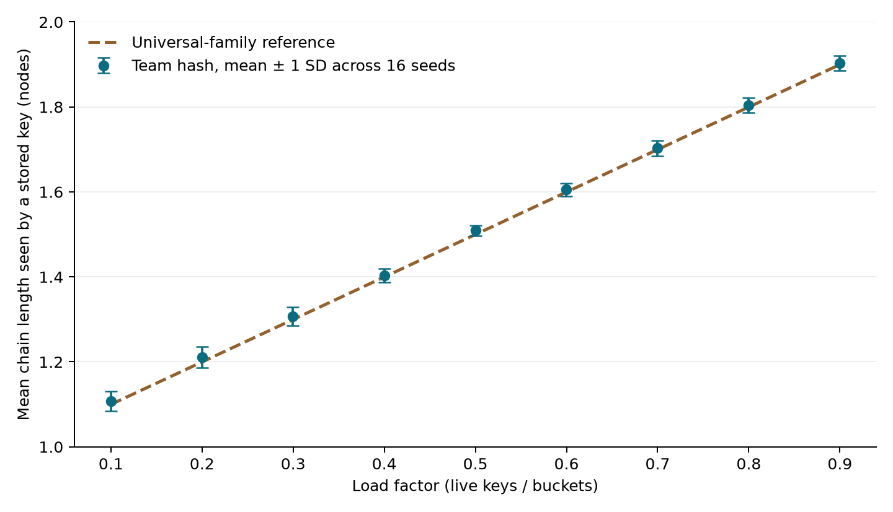

Q3. Why does linear probing need tombstones?

Author: Pankaj

Suppose two different keys, apple and mango, both start at slot 2. Apple gets slot 2. Mango sees slot 2 is occupied, so it moves to slot 3.

| State | Slot 2 | Slot 3 |
|---|---|---|
| Before deletion | apple | mango |
| Incorrect deletion | EMPTY | mango |
| Deletion with a tombstone | TOMBSTONE | mango |

A search for mango starts at slot 2. If deleting apple marks slot 2 EMPTY, the search stops there and wrongly reports that mango is missing. If slot 2 is a TOMBSTONE, the search continues to slot 3 and finds mango. In Structure B, `remove()` sets the slot to TOMBSTONE, and `get()` only stops early when it sees EMPTY.

## Q5. How does a random seed affect the chain containing a stored key?

**Member 5 · Adwit Tiwari**

Fix a set of n distinct keys and choose one stored key x. Its chain already contains x. Every other key y adds one more node exactly when y and x land in the same bucket. A universal family chooses a hash function at random such that, for each fixed pair of distinct keys, the probability of a shared bucket is at most 1/m, where m is the number of buckets. Summing the n − 1 collision probabilities gives

**E[length of x’s chain] ≤ 1 + (n − 1)/m = 1 + α − 1/m**, where α = n/m.

The expectation is over the hash choice. Linearity of expectation lets us add these probabilities even when the collision events depend on each other. If each pair collides with probability exactly 1/m, the bound is an equality. At half load, a stored key therefore sees about 1.5 nodes in its full chain under that model. A lookup can stop before reaching the end of the chain.

### What the team's code does

The fixed hash uses base 31. The team's `SeededHash` restarts a pseudorandom generator from the same seed on every call, producing one repeatable coefficient per character position. It multiplies each coefficient by the corresponding unsigned byte plus one, sums modulo 1,000,000,007, and Structure A reduces the result modulo the bucket count. All keys in a table use the same coefficients. A different seed changes how the original characters contribute, so two strings that shared a fixed hash can move apart. Applying a seed only to their already equal hash values would give equal outputs again.

The bound above assumes a pairwise collision guarantee for the **final bucket index**, with the input chosen independently of the hash. Pseudorandom coefficients and a final reduction modulo m warrant an empirical check. Knowing the seed and then choosing the inputs falls outside that assumption.

### What the implementation measured

We held the input sequence fixed and varied only the hash seed at each load. With 4,096 buckets and 16 seeds, we looked up every stored key at each of nine loads and verified its value. A bucket of length k is seen by k stored keys, so the measured mean full chain length is the sum of k² over buckets divided by n. We checked this against the table's actual successful lookup counts at every load.

| Nominal load | Distinct keys | Universal-family reference | Measured full chain (nodes) | Successful lookup (nodes compared) |
| --- | ---: | ---: | ---: | ---: |
| 0.1 | 409 | 1.100 | 1.108 | 1.054 |
| 0.5 | 2,048 | 1.500 | 1.509 | 1.255 |
| 0.9 | 3,686 | 1.900 | 1.903 | 1.452 |

At the highest load, the complete chain averaged 1.903 nodes and a successful lookup examined 1.452. The difference comes from stopping when the requested key is found. The finite-seed averages tracked the reference across this input set. An expectation bound allows individual samples and finite averages on either side of the reference. A guarantee for every fixed pair would require a separate proof for the implemented family.

[Measurement protocol and build commands](bench/SEEDED_HASH_NOTES.md) · [Raw runs](results/q5_chain_length.csv) · [Team implementation](src/structA/StructureA.cpp) · [James Aspnes, Yale, *Randomization*, section on universal hashing](https://www.cs.yale.edu/homes/aspnes/pinewiki/C%282f%29Randomization.html)
